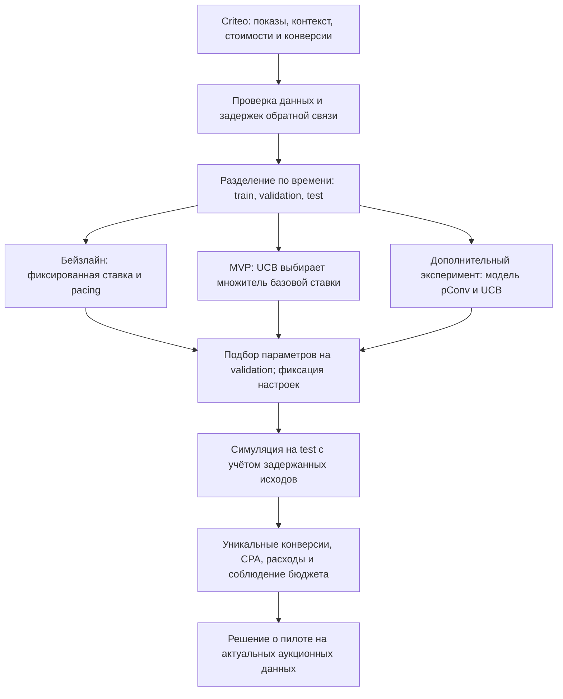
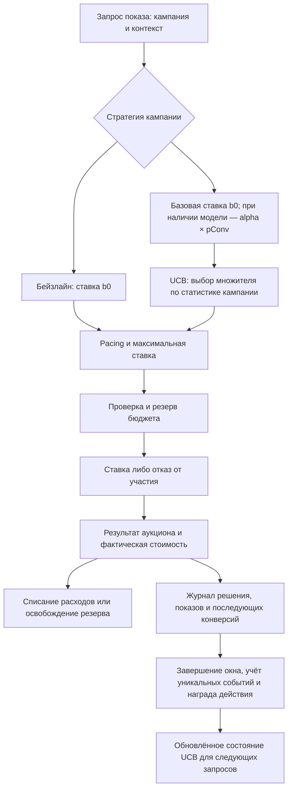

# Дизайн ML-системы: Auto Bidding System

**Версия:** MVP, итерация 1. **Дата:** 18.11.2026.
**Статус:** EDA выполнен; модели, стратегии и пилот находятся на этапе проектирования.

Документ подготовлен по [шаблону Reliable ML](https://github.com/IrinaGoloshchapova/ml_system_design_doc_ru/blob/main/ML_System_Design_Doc_Template.md).
Раздел 1 описывает цели и ожидания бизнеса, раздел 2 — подход к решению,
раздел 3 — проверку результата, раздел 4 — требования к внедрению.

## Термины и пояснения

| Термин | Значение |
| --- | --- |
| RTB | Покупка рекламного показа через аукцион в реальном времени |
| DSP | Система на стороне рекламодателя, которая решает, участвовать ли в аукционе и какую ставку предложить |
| UCB | Семейство алгоритмов выбора действия по верхней доверительной оценке его результативности |
| Рука UCB | Один из доступных вариантов действия; в проекте — множитель базовой ставки |
| pConv | Прогноз вероятности конверсии в течение 30 дней после показа |
| CPA | Расходы на рекламу, разделённые на число уникальных конверсий |
| Pacing | Управление темпом расходования бюджета в течение дня |
| Итерация | Работы, которые нужно выполнить до очередной проверки решения на пилоте |

## 1. Цели и предпосылки

### 1.1. Зачем идем в разработку продукта?

#### Бизнес-цель

Помочь рекламодателю получать больше конверсий при заданном дневном бюджете.
Рекламодатель задаёт ограничения кампании, а система выбирает ставки и следит
за тем, чтобы бюджет расходовался постепенно. Оператор рекламной платформы
контролирует работу системы и разбирает отклонения.

В качестве исходного подхода принимаем фиксированную ставку. Она проста,
но не меняется в зависимости от результатов кампании. При изменении трафика
одна и та же ставка может приводить либо к лишним расходам, либо к потере
полезных показов. Здесь и далее это наш бейзлайн, а не описание алгоритмов Criteo.

#### Почему ожидаем улучшение

UCB позволит сравнивать несколько уровней ставки и постепенно отдавать
предпочтение тем, которые приносят больше конверсий. При этом алгоритм продолжит
проверять менее изученные варианты, чтобы не зафиксироваться слишком рано
на случайно удачной ставке.

Если одного управления уровнем ставки окажется недостаточно, добавим прогноз
pConv. Он позволит различать показы внутри кампании: для более перспективного
контекста базовая ставка будет выше. UCB и прогнозная модель решают разные задачи:
первый выбирает уровень ставки, вторая оценивает конкретный показ.

#### Что считаем успехом итерации

Получить воспроизводимое сравнение фиксированной ставки и UCB при одинаковых
бюджетах и ограничениях. Рабочая бизнес-гипотеза — не менее 5% прироста уникальных
конверсий без превышения бюджета. Это целевой ориентир, а не полученный результат;
после исследования данных нужно проверить, позволяет ли объём событий измерить
такой эффект. Вместе с конверсиями оцениваем CPA и освоение бюджета.

### 1.2. Бизнес-требования и ограничения

#### Бизнес-требования

| ID | Требование | Ожидаемое поведение |
| --- | --- | --- |
| БТ-1 | Управлять ограничениями каждой кампании | Рекламодатель задаёт дневной бюджет и максимальную ставку |
| БТ-2 | Автоматически выбирать ставку | На запрос показа система отвечает ставкой либо отказом от участия |
| БТ-3 | Соблюдать бюджет | Расход и обязательства по открытым ставкам не превышают доступный лимит |
| БТ-4 | Распределять расходы по времени | Система снижает активность при опережении плана расходов и повышает при отставании |
| БТ-5 | Улучшать результат кампании | UCB сравнивает уровни ставки по обратной связи о конверсиях |
| БТ-6 | Объяснять решения | Можно восстановить выбранный вариант, ставку, состояние бюджета и версию алгоритма |
| БТ-7 | Безопасно отключать неудачную стратегию | Доступен возврат к фиксированной ставке при исправном контроле бюджета |

#### Бизнес-ограничения

Бюджет и максимальная ставка — жёсткие ограничения. CPA используем для сравнения
результатов, но отдельный целевой CPA в первой версии не задаём. Исследование
новых вариантов UCB тоже расходует бюджет, поэтому для него нужен ограниченный
лимит, общий с основными расходами кампании.

Для разработки используем открытый Criteo Attribution Modeling for Bidding Dataset.
Его лицензия **CC BY-NC-SA 4.0** допускает только некоммерческое использование
при соблюдении остальных условий. Данные подходят для исследования решения;
коммерческий запуск требует собственных данных или других прав на использование.

Данные содержат только состоявшиеся показы, а стоимости преобразованы.
Поэтому расчёты ведём в условных единицах и не переносим офлайн-CPA в реальную
валюту. Полноценную оценку новых ставок на всех аукционах эти логи не обеспечивают.

#### Ожидания от итерации и процесс пилота

Сначала проверяем качество данных, затем сравниваем бейзлайн и UCB в симуляторе.
Оператор задаёт кампании, бюджет и ограничения; на выходе получает отчёт
по конверсиям, CPA, расходам и поведению алгоритма. Прогноз pConv добавляем
отдельным экспериментом, если анализ покажет пользу контекстных признаков.

Успешный офлайн-этап даёт основание подготовить пилот на актуальном потоке
аукционов. Перед реальными расходами нужны проверка без отправки ставок,
лимит бюджета эксперимента и возможность быстро вернуть бейзлайн.
Критерии оценки пилота приведены в разделе 3.

### 1.3. Что входит в скоуп проекта/итерации, что не входит

#### Что делаем в MVP

- Готовим данные Criteo и отчёт об их качестве.
- Реализуем фиксированную ставку и UCB для выбора множителя ставки по кампании.
- Подключаем общий контроль бюджета и pacing для всех стратегий.
- Сравниваем стратегии в симуляторе и сохраняем настройки и результаты запуска.
- Проверяем необходимость модели pConv; добавляем её, если эксперимент
  подтверждает пользу относительно UCB без прогнозной модели.

В рамках MVP закрываем БТ-1–БТ-6 на уровне локального прототипа,
а БТ-7 — переключением стратегии в конфигурации. Гарантии бюджетного контроля
при параллельных реальных торгах проверяются отдельно перед внедрением.

#### Что не делаем в этой итерации

Не подключаем реальные рекламные биржи, платежи и интерфейс рекламодателя.
Не разрабатываем собственную модель атрибуции или оценку причинного эффекта
рекламы. Промышленная отказоустойчивость и распределённое управление бюджетом
относятся к следующему этапу.

#### Качество решения и технический долг

Каждый эксперимент должен сохранять версию кода и данных, временные границы
выборок, набор действий UCB, параметры pacing и seed. Проверки кода выполняются
через Ruff и pre-commit. Результаты должны воспроизводиться по этим настройкам.

Основной технический долг — ограниченная симуляция аукциона, отсутствие
промышленного хранилища состояния UCB и распределённого учёта бюджета.
Перед запуском в реальной DSP эти части нужно заменить или проверить на
полном потоке запросов, а не только на исторически купленных показах.

### 1.4. Предпосылки решения

**Единица решения — запрос на показ в рамках кампании.** UCB ведёт отдельную
статистику по кампаниям, поскольку аудитория, цены и частота конверсий различаются.
Набор действий небольшой и фиксируется до теста: например, множители
`0.5`, `0.75`, `1.0`, `1.25`, `1.5`. Это стартовая сетка для эксперимента,
которую уточним на валидации, а не по результатам тестовой выборки.

**Горизонт результата — 30 дней после показа.** Так определён `conversion`
в [карточке Criteo](https://huggingface.co/datasets/criteo/criteo-attribution-dataset).
Конверсия появляется не сразу; отсутствие события сегодня ещё не означает
отрицательный результат. Это влияет и на обучение модели, и на обновление UCB.

**Контроль бюджета отделён от выбора ставки.** Даже если UCB или прогнозная
модель ошибаются, система обязана соблюдать лимиты. Дневной бюджет и максимальная
ставка задаются отдельно для каждой кампании.

**Прогноз конверсии — дополнительный компонент.** Первая версия UCB может
работать с постоянной базовой ставкой. Если добавляется модель, для начала
используем логистическую регрессию с категориальными признаками. Более сложный
алгоритм имеет смысл только после проверки этой версии.

**Данные исследованы.** Полный аудит выявил 16 468 027 показов за 31 день,
675 кампаний и 438 730 составных событий конверсии. Объём подходит для
ретроспективного исследования pConv, но задержки меток ограничивают проверку UCB;
подробности и правила подготовки приведены в разделе 2.3.

## 2. Методология

### 2.1. Постановка задачи

Основная задача — последовательный выбор ставки при ограниченном бюджете.
Мы рассматриваем её как задачу многорукого бандита: каждый вариант ставки —
отдельное действие, результат которого известен с задержкой. Цель — получить
больше уникальных конверсий за день, не превысив бюджет кампании.

#### Бейзлайн

Фиксированная базовая ставка `b0` с ограничением максимальной ставки и pacing.
Параметры подбираются на валидации. Бейзлайн нужен для проверки того, приносит
ли адаптация ставок пользу относительно простого стабильного решения.

#### Основное решение: семейство UCB

Решение не привязано к одной версии UCB. Рассматриваем UCB1 как начальный
вариант, KL-UCB для бинарного вознаграждения, а также Sliding-Window UCB
и Discounted UCB, которые позволяют учитывать изменение результатов во времени.
При переходе к выбору действия с учётом контекста показа можно отдельно
рассмотреть LinUCB; это альтернатива неконтекстному выбору множителя,
а не другое название модели pConv.

Конкретный алгоритм выбираем на валидации по бизнес-метрикам, устойчивости
к задержкам и стоимости исследования. Для каждого кандидата отдельно определяем
статистику, обработку ожидающих исходов и параметры; формула ниже иллюстрирует
начальный вариант UCB1 и не задаёт обязательную формулу для всего семейства.

В начальном неконтекстном варианте на каждом допустимом запросе UCB выбирает
множитель `m` базовой ставки.
Для каждого множителя храним число завершённых наблюдений и среднее вознаграждение.
В начальном варианте оценка складывается из среднего результата и бонуса
за неопределённость:

```text
score(a) = mean_reward(a) + c × sqrt(log(1 + N) / n(a))
```

Здесь `n(a)` — число завершённых наблюдений для действия, `N` — их общее число
в кампании, `c` — параметр исследования. Для варианта без завершённых наблюдений
формулу не вычисляем: начальные действия чередуются, а их доля и расходы
ограничены настройками исследования. Ожидающие результата запросы учитываются
отдельно, чтобы задержка конверсий не приводила к бесконтрольному исследованию.

Обратная связь привязывается к выбранному действию, а не ко всем вариантам
ставки сразу. Для проигранного аукциона вознаграждение равно нулю; для купленного
показа оно остаётся неизвестным до завершения окна наблюдения. После этого
засчитываем `1`, если показу назначена уникальная конверсия, иначе `0`.
Событие определяется ключом `(uid, conversion_id, conversion_timestamp)`:
EDA выявил совпадения `conversion_id` у разных пользователей.
Если событие связано с несколькими купленными показами кампании, один кредит
получает последний из них до события в пределах окна. Это единое правило учёта
для эксперимента, а не попытка восстановить причинное влияние рекламы.
В проектном отчёте одно событие повторно дедуплицируется между кампаниями.

Обновления выполняются только по завершённым исходам; ранние положительные
конверсии не смешиваются с ещё незавершёнными отрицательными. Состояние UCB
сохраняется между днями, дневной счётчик расходов сбрасывается отдельно.
При смене набора действий или формулы базовой ставки используется новая версия
состояния: статистику разных стратегий нельзя молча объединять.

UCB помогает управлять исследованием, но сам по себе не решает задачу
оптимального распределения бюджета при разных ценах действий. Бюджет и pacing
контролируются отдельно; полезность сочетания проверяется экспериментом.
Теоретические гарантии обычного UCB не переносим автоматически на задержанные,
зависимые конверсии и меняющийся рекламный трафик.

#### При необходимости: прогноз вероятности конверсии

Модель оценивает `P(conversion = 1 | контекст показа)`. Она использует только
признаки, доступные до решения: время, кампанию и категориальный контекст.
Первый кандидат — логистическая регрессия с кодированием категорий и проверкой
калибровки. Модель обучается по кампаниям совместно, с идентификатором кампании
как признаком.

Без модели базовая ставка равна `b0`. С моделью она равна `alpha × pConv(x)`.
В обоих случаях итоговый расчёт одинаков:

```text
bid = min(b_max, base_bid(x) × selected_ucb_multiplier × pacing_multiplier)
```

После расчёта система проверяет доступный бюджет. Для бейзлайна множитель UCB
равен единице. Прогноз pConv не заменяет реальные конверсии в вознаграждении UCB.
Решение о подключении модели принимается по дополнительному приросту конверсий
при том же бюджете, а не только по качеству классификации.

### 2.2. Блок-схема решения

#### Подготовка и сравнение вариантов



#### Обработка запроса и обратная связь



В симуляторе Criteo заменяет поток запросов, а правило покупки по `cost` —
результат аукциона. В сервисе статистика UCB и бюджет доступны между запросами.
Модель pConv, если она включена, обновляется отдельным процессом обучения;
каждая новая версия проверяется до подключения к торгам.

### 2.3. Этапы решения задачи

#### Этап 1. Подготовка данных

**Вход:** статическая публикация [Criteo Attribution Modeling for Bidding](https://huggingface.co/datasets/criteo/criteo-attribution-dataset).
Полный набор исследован; результаты, графики и ограничения приведены в
[отчёте EDA](../reports/eda/README.md), расчёты — в
[ноутбуке](../notebooks/01_criteo_eda.ipynb). Ревизия, размер и SHA-256 архива
сохранены в [манифесте](../reports/eda/manifest.json).

**Как формируются данные.** Источник — анонимизированная подвыборка показов
из работающей системы Criteo с присоединёнными кликами, конверсиями и атрибуцией.
Одна строка соответствует состоявшемуся показу, а не всем запросам биржи.
Исходный файл — TSV с заголовком, сжатый gzip. Это фиксированный публичный
снимок: регулярное пополнение и точный механизм сэмплирования не раскрыты.
В будущей DSP запросы будут поступать непрерывно, результаты аукционов и расходы —
отдельными событиями, а конверсии — с задержкой. Такой поток ещё нужно получить
для онлайн-пилота; открытый архив его не заменяет.

**Объём и качество.** В архиве 16 468 027 строк, 22 поля, 6 142 256 пользователей
и 675 кампаний. Время показов — от 0 до 2 671 199 секунд: фактически 31 день,
хотя карточка описывает примерно 30 дней. Положительных строк 806 196 (4,8955%).
SQL-проверки не выявили NULL, полных дубликатов, недопустимых бинарных меток,
нулевых или отрицательных стоимостей, отрицательных задержек конверсии или
задержек за пределами 30-дневного окна. Это результаты конкретных проверок,
а не гарантия отсутствия всех ошибок.

| Сущность | Поля и применение | Что показал EDA |
| --- | --- | --- |
| Контекст показа | `timestamp`, `campaign`, `cat1`–`cat9`; кандидаты в признаки | У `cat7` 57 196 категорий; нужны разреженное кодирование и обработка неизвестных значений |
| История пользователя | `uid` для связей; `time_since_last_click` как возможный признак | В 53,26% строк время с прошлого клика равно `-1`; это отдельное состояние, а не отрицательная длительность |
| Целевая метка | `conversion`: событие в течение следующих 30 дней | Несколько строк могут относиться к одному событию; строковую долю нельзя выдавать за число конверсий |
| Событие конверсии | `uid`, `conversion_id`, `conversion_timestamp` | 438 730 составных событий; только 435 810 различных `conversion_id` |
| Историческая атрибуция | `attribution`, только для дополнительной оценки | Не равна факту конверсии и не становится признаком текущего показа |
| Расходы | `cost` для оценки; `cpo` не используется в основной задаче | Цены положительные, но преобразованные: доступны относительные сравнения в условных единицах |

**Ключ события.** У 2 910 значений `conversion_id` обнаружены разные пользователи
и времена события. Причина совпадений в публикации не раскрыта. Пара
`(uid, conversion_id)` в этих данных однозначно определяет время конверсии;
для явного учёта используем `(uid, conversion_id, conversion_timestamp)`.
Он даёт 438 730 событий, без пересечений между кампаниями внутри такого ключа.
До передачи метрик в бизнес проверяем контракт ключа на каждом новом источнике.
Сырые значения идентификаторов в отчёт не публикуем.

**Подготовка.** Исходный архив сохраняем неизменным. Читаем по фиксированной
схеме, считаем ошибки до фильтрации, проверяем типы, метки и время. Будущий
пайплайн исключает из эксперимента записи с некорректной стоимостью или
противоречивой разметкой, сохраняя число исключений и причины. В текущем аудите
записи не удалялись. `-1` у полей отсутствующей конверсии — служебное значение;
такие строки являются отрицательными примерами, если окно наблюдения завершено.
`time_since_last_click=-1` кодируем отдельным индикатором отсутствия истории;
перед включением проверяем семантику и доступность в момент ставки.

**Защита от утечки.** В первую модель входят только время, кампания и `cat1`–`cat9`.
`click`, `click_pos`, `click_nb`, `conversion_timestamp`, `conversion_id`,
`attribution`, `cost` и `cpo` не подаются на вход расчёта ставки. Исторические
агрегаты строятся строго по прошлым событиям; целевые кодировки по всей таблице
недопустимы. `uid` не используем как обучаемую категорию первой модели.

**Достаточность.** Для исследования pConv положительных строк достаточно,
но их зависимость и неравномерность требуют отдельной оценки по кампаниям:
у 279 кампаний меньше 100 уникальных составных событий,
у четырёх — меньше 10. Эти пороги описательные и не доказывают статистическую
мощность. Полная кампания и её составные события доступны в агрегатах отчёта.
Общая модель предпочтительнее отдельных моделей для каждого рекламодателя.

Для UCB данных существенно меньше, чем кажется по числу строк: медианная
задержка положительной строки около 3,74 дня, 95-й процентиль — около 25,13 дня.
Полное 30-дневное окно успевает истечь до конца потока показов только у 544 426
строк (3,31%). Это лишь календарная возможность завершения, не доказательство
полноты сбора исходов. Нельзя подавать готовые метки в UCB сразу после ставки.

Для честного цикла «сбор → ожидание меток → обновление → новая оценка» нужен
более длинный поток. Минимум — train-период + 30 дней ожидания его меток +
validation-период + 30 дней ожидания + test-период + 30 дней наблюдения исходов
теста. Конкретная продолжительность каждого периода зависит от числа событий,
числа действий и допустимого бюджета исследования. Размер онлайн-пилота
рассчитываем по дисперсии и зависимости результатов на актуальных данных;
сейчас обоснованного числа дополнительных показов нет. Нужны также проигранные
аукционы, журнал выбранных ставок и подтверждённая граница наблюдения конверсий.

**Конфиденциальность.** Идентификаторы анонимизированы, но позволяют связывать
историю пользователя; не считаем их автоматически безопасными для публикации.
Архив и локальная БД исключены из Git, в отчёте только агрегаты без пользовательских
значений. Права доступа и срок хранения задаются для реальной интеграции отдельно.
Соблюдаем CC BY-NC-SA 4.0 и указание авторства; коммерческий запуск требует
собственных данных или необходимых прав.

**Результат этапа:** проверенный снимок, манифест, словарь полей, агрегаты EDA,
правила ключей, допустимых признаков и обработки ошибок. Условие перехода —
подтверждённая разметка для выбранного режима оценки; отсутствие полного потока
и короткая история явно ограничивают выводы.

#### Этап 2. Подготовка прогнозных моделей

**Назначение и вход.** pConv — дополнительный компонент. Он оценивает вероятность
`conversion=1` в следующие 30 дней по доступному до показа контексту. Вход —
подготовленные данные этапа 1. UCB без pConv остаётся самостоятельным вариантом.
На этом этапе описан процесс моделирования; модели ещё не обучены.

**Два прогнозных бейзлайна.** Первый всегда возвращает долю положительных
строк train. Это нижняя точка сравнения вероятностной модели. Второй —
логистическая регрессия: `campaign` и `cat1`–`cat9` кодируются разреженным
one-hot с обработкой неизвестных категорий; из относительного времени получаем
положение внутри суток. Календарные даты и день недели из анонимизированного
времени не предполагаем. Преобразования обучаются только на train.
Высокая кардинальность `cat7` требует контроля памяти; hashing — альтернативный
вариант для сравнения, а не обязательное дополнительное кодирование.

**Функция потерь и ML-метрики.** Для логистической регрессии используем бинарную
кросс-энтропию с регуляризацией. Основная вероятностная метрика — log loss;
плохая уверенность напрямую искажает ставку `alpha × pConv`. Дополнительно
оцениваем PR-AUC (average precision) для ранжирования положительных примеров,
Brier score и диаграмму калибровки. PR-AUC сравнивается с долей положительного
класса соответствующей выборки. Accuracy не подходит для основной оценки.
Балансировку классов и отрицательный сэмплинг не включаем автоматически:
они меняют оценку вероятностей и требуют корректировки и повторной калибровки.

**Валидация.** Для ретроспективного исследования фиксируем временные границы
60/20/20 по длительности потока: train до 1 607 720 секунды, validation до
2 136 960, test — оставшийся период. Это соответственно 9 941 432,
3 344 259 и 3 182 336 строк. При необходимости первую половину validation
по времени используем для калибровки, вторую — для настройки ставок и выбора
стратегии. Test не используется для подбора параметров. EDA тестовой части
ограничен аудитом качества и покрытия, а не поиском выигрышных правил.

Временной split не устраняет зависимость меток: события и пользователи
пересекают границы. Пересечения измерены в отчёте, случайное перемешивание
ещё сильнее исказило бы оценку. Для дополнительной диагностики оцениваем отдельно
новых и возвращающихся пользователей. При необходимости групповой проверки
целое событие исключается из более ранней части, если оно встречается позднее;
исключения и изменение покрытия отражаются отдельно.

**Реалистичная проверка.** В момент обучения допускаются лишь показы с завершённым
30-дневным окном и подтверждённым сбором исходов. И положительные, и отрицательные
метки проходят одинаковое правило ожидания. Текущие 31 день не позволяют честно
воспроизвести независимые train/validation/test с таким ожиданием. Поэтому
результаты обычного split обозначаются ретроспективными; production-качество
на их основе не заявляем. Для пилота используем расширенную историю из этапа 1.

**Развитие.** Сначала проверяем логистическую регрессию, затем градиентный
бустинг с корректной обработкой категорий. Кандидаты в FE: число прошлых контактов,
давность показа кампании, агрегаты по времени и кампании. Любые статистики
строятся на момент решения, а метки учитываются только после созревания.
Ограниченный поиск регуляризации, кодирования и параметров бустинга проводится
на validation; бюджет экспериментов и ресурсы сохраняются в конфигурации.

**Интерпретация.** Анализируем коэффициенты логистической регрессии по обезличенным
категориям, устойчивость признаков и ошибки по кампаниям и временным срезам.
Для бустинга рассматриваем permutation importance на отложенных данных.
Проверяем калибровку в группах, а не только общую метрику; редким кампаниям
не приписываем надёжность по нескольким событиям. Семантика `cat*` скрыта,
поэтому коэффициент категории не превращаем в бизнес-объяснение её смысла.

**Риски:** повторные контакты, утечка будущих событий, новые категории, нестабильные
редкие кампании и сдвиг трафика. Меры — временная валидация, проверки доступности
признаков, контроль пересечений и памяти, срезы качества и калибровка.
В test у `cat3` около 1,30% строк содержат категории, отсутствующие в train;
это уже наблюдаемая причина предусмотреть unknown-обработку.

**Результат этапа:** воспроизводимые прогнозные бейзлайны, отчёт ML-метрик,
калибровки и ошибок, измеренная задержка инференса. Подключение pConv разрешает
отдельное сравнение «UCB» и «UCB + pConv» при одинаковых бюджетах; улучшение
классификации само по себе не доказывает прирост конверсий.

#### Этап 3. Выбор стратегии семейства UCB

**Вход:** события и доступная обратная связь этапа 1, базовая ставка `b0`
либо проверенный прогноз этапа 2. Действия — фиксированные множители ставки
по кампании. Сравниваем UCB1, KL-UCB, варианты со скользящим окном и затуханием;
LinUCB рассматриваем отдельно при использовании контекста в выборе действия.
Набор действий и параметры исследования фиксируются по validation.

Состояние хранит выбранное действие, версию стратегии, завершённые наблюдения
и очередь ожидающих наград. Только выбранное действие получает обратную связь.
Проигранный аукцион даёт нулевую награду; купленный показ остаётся незавершённым
до полного окна. Среди выбранных показов, связанных с одним составным событием,
кредит получает последний до конверсии; повторная доставка не начисляет его снова.
Это правило отчётности, а не оценка причинного вклада рекламы.

Главный риск — задержки и нехватка событий на кампанию. Ограничиваем расходы
исследования, показываем долю незавершённых решений, не подменяем награду pConv
или кликом. Статистику разных версий не смешиваем; состояние восстанавливаем
после перезапуска. На Criteo отделяем проверку работоспособности алгоритма от
доказательства способности адаптироваться. Ускоренная обратная связь возможна
только в явно синтетическом тесте, без бизнес-выводов.

**Результат:** сравнение кандидатов на одинаковом потоке с доступными на каждом
шаге исходами. Переход дальше — только при достаточной обратной связи и соблюдении
лимитов; иначе требуется расширение данных, а не выбор по случайному выигрышу.

#### Этап 4. Контроль ставок и бюджета

**Вход:** выбранный множитель, базовая ставка и ограничения кампании. Общий
контроллер pacing сравнивает расход с планом дня, ограничивает итоговую ставку
и отказывает при недостаточном остатке. В локальной оценке день равен 86 400
секундам от начала потока; одинаковые правила применяются ко всем стратегиям.

Сценарий сравнения — дневной бюджет 50% среднего дневного расхода кампании на
validation; настройки фиксируются до test. Кампании без истории идут отдельным
срезом. Бюджет исследования UCB включён в общий лимит, а не добавляется сверх него.
Для сервиса резервируем максимальные обязательства до отправки ставки,
сверяем фактический расход и обрабатываем события идемпотентно.

**Риски:** параллельные запросы, потеря подтверждения и длинные хвосты стоимости.
Контроль — атомарные резервы, сверка обязательств и отказ при неизвестном остатке.
**Результат:** отсутствие перерасхода в тестах и воспроизводимый профиль расходов;
нагрузочные и аварийные проверки обязательны перед реальными торгами.

#### Этап 5. Офлайн-оценка и подготовка пилота

**Вход:** фиксированные стратегии, правила бюджета, метрики и журнал эксперимента.
Симулятор проходит наблюдавшиеся показы по времени. Допущение: `cost` служит
условным порогом покупки; при достаточной ставке и остатке списывается `cost`.
Это не подтверждённая цена для альтернативной ставки в реальном аукционе.
Алгоритм не видит стоимость или будущие исходы до принятия решения.

Сравниваем фиксированную ставку, UCB и при необходимости UCB + pConv.
Основная метрика — уникальные составные события, дополнительные — CPA, расходы,
освоение бюджета и неопределённость результата. Дневные уникальные события
нельзя просто суммировать за период; выполняем повторную дедупликацию.
Ноль конверсий означает неопределённый CPA. Отчёт по исторической атрибуции
Criteo — отдельный срез, он не пересчитывается как новая причинная атрибуция.

Исторически отобранные показы, анонимизация, преобразованные стоимости
и незавершённые окна ограничивают любые выводы о реальном рынке.
Полный поток с действиями логирующей стратегии и вероятностями их выбора нужен
для обоснованной off-policy-оценки; необходимых вероятностей в публикации нет.
При недостатке независимых временных блоков не заявляем статистическую значимость.

**Результат:** отчёт с ограничениями, ресурсами, бизнес-метриками и решением
о продолжении. Условие пилота — актуальные данные с подтверждёнными метками,
права использования, безопасный бюджет и возможность отката. Онлайн-пилот
планируем отдельно с учётом 30-дневного ожидания конверсий.

## 3. Подготовка пилота

### 3.1. Способ оценки пилота

Первый этап — сравнение в симуляторе. Основная метрика — число уникальных
событий `(uid, conversion_id, conversion_timestamp)` у выбранных показов. Значение `-1` исключается; в итоговом отчёте
события повторно не считаются между днями и кампаниями. Дополнительно показываем
CPA, расходы, долю освоенного бюджета, профиль расходов и долю действий UCB,
для которых результат ещё неизвестен. При нуле конверсий CPA не определён.

Сравнение проводим попарно по кампаниям и дням. При достаточном количестве дней
оцениваем неопределённость эффекта с помощью блочного bootstrap, сохраняя
обе стратегии в одном блоке и пересчитывая уникальные конверсии.
При недостатке событий не заявляем статистическую значимость.

Данные Criteo отражают выбор прежней стратегии, а исходов проигранных аукционов
нет. Поэтому офлайн-результат не доказывает рост реальных конверсий и не измеряет
причинный эффект рекламы. Следующий этап — контролируемое онлайн-сравнение
на непересекающихся группах кампаний с отдельными бюджетами. Размер, длительность
и распределение групп определяются по фактическому трафику и задержкам до запуска.

### 3.2. Что считаем успешным пилотом

Рабочая цель — прирост уникальных конверсий не менее 5% при одинаковом бюджете,
без его превышения и без нарушения максимальной ставки. CPA и освоение бюджета
рассматриваем вместе с основной метрикой, чтобы не принять рост расходов
или случайный всплеск за улучшение стратегии.

Пилот успешен, если эффект устойчив, обратная связь корректна, расходы
контролируются и операторы могут объяснить выбор ставки. Если исследование UCB
не успевает завершиться из-за задержек или малой частоты конверсий, сначала
пересматриваем данные и длительность наблюдения, а не объявляем алгоритм успешным.

### 3.3. Подготовка пилота

До начала пилота оцениваем ресурсы на обработку данных, хранение состояния
по кампаниям и ожидаемую задержку ответа. Для прототипа принимаем ориентир:
p95 обработки запроса до 50 мс при 100 запросах/с на одном экземпляре.
Это цель нагрузочной проверки, а не измеренный SLA.

Фиксируем допустимый бюджет исследования, правила остановки и возврата к
бейзлайну. Для коммерческого пилота проверяем права на данные, подключение биржи
и сверку фактических расходов. При неопределённом состоянии бюджета ставки
останавливаются.

## 4. Внедрение

### 4.1. Архитектура решения

Сервис ставок получает контекст запроса и настройки кампании, выбирает действие
UCB, рассчитывает ставку и обращается к контролю бюджета. Хранилище состояния
содержит статистику действий и ожидающие результаты. Обработчик событий
связывает показы и конверсии, завершает наблюдения и обновляет статистику.
При наличии pConv процесс обучения публикует проверенные версии модели отдельно.

### 4.2. Описание инфраструктуры и масштабируемости

Для MVP достаточно локального последовательного симулятора и сохраняемого
состояния эксперимента. Это позволяет проверить алгоритм без инфраструктуры биржи.
Для параллельного сервиса понадобятся общее хранилище состояния UCB,
атомарный учёт бюджета и очередь событий с защитой от повторной обработки.
Выбор конкретных сервисов сделаем по результатам прототипа и нагрузочной проверки.

### 4.3. Требования к работе системы

Перед отправкой ставки резервируется максимальное обязательство, после исхода
аукциона оно заменяется расходом или освобождается. Потерянное подтверждение
требует сверки: резерв нельзя освобождать только по таймауту, если расход возможен.
Сбой UCB допускает возврат к бейзлайну; сбой контроля бюджета означает отказ
от торгов. Сбой дополнительной модели допускает переход на версию UCB без pConv
с отдельным состоянием.

### 4.4. Безопасность системы

Доступ к настройкам кампаний и запуску стратегий должен быть ограничен ролями.
Изменения лимитов и переключения стратегий журналируются. Секреты подключения
к биржам хранятся вне репозитория.

### 4.5. Безопасность данных

Пользовательские идентификаторы не публикуются в отчётах и примерах.
Доступ к исходным данным и сроки их хранения ограничиваются задачами проекта;
условия лицензии сохраняются для производных данных. Для реальной интеграции
потребуется отдельная проверка требований к обработке данных пользователей.

### 4.6. Издержки

Основные затраты — подготовка данных, хранение истории и ожидающих исходов,
обработка запросов и, при необходимости, обучение pConv. Денежную оценку можно
сделать после измерения объёма состояния и времени обработки; сейчас подтверждённого
расчёта стоимости инфраструктуры нет. Рекламный бюджет учитывается отдельно.

### 4.7. Точки интеграции

Внешние точки — поток запросов биржи, результаты аукционов и события конверсий.
Внутренние — настройки кампании, бюджетный учёт, состояние UCB и хранилище моделей.
Решение и последующие события связываются по идентификатору запроса; повторная
доставка события не должна повторно менять расходы или награду. Контракты API
определяются при подключении конкретной биржи.

### 4.8. Риски

| Риск | Как повлияет | Что делаем |
| --- | --- | --- |
| Мало конверсий или длинная задержка | UCB долго не различает действия | Ограничиваем исследование; проверяем достаточность истории до пилота |
| Исторически отобранные показы | Офлайн-эффект не переносится на весь аукцион | Не делаем выводов о полном рынке без новых данных и онлайн-проверки |
| Преобразованные стоимости | Нельзя получить достоверный валютный CPA | Работаем в условных единицах и явно фиксируем допущения симулятора |
| Повторные показы перед одной конверсией | Вознаграждение и бизнес-метрики завышаются | Один кредит событию по общему правилу, дедупликация итогов |
| Изменение аудитории и цен | Накопленные оценки UCB устаревают | Следим за результатами по времени; проверяем необходимость ограниченного окна статистики |
| Параллельные ставки или повторные события | Возможен перерасход и неверные обновления | Резервируем бюджет, сохраняем состояние, обрабатываем события идемпотентно |

Мониторим расходы, обязательства, темп освоения бюджета, задержку ответа,
ошибки, распределение выбранных действий и долю незавершённых наград UCB.
Для pConv дополнительно контролируем калибровку на созревших метках.

## Источники

1. [Reliable ML: шаблон дизайн-документа](https://github.com/IrinaGoloshchapova/ml_system_design_doc_ru/blob/main/ML_System_Design_Doc_Template.md).
2. [Criteo Attribution Modeling for Bidding: описание и условия использования](https://huggingface.co/datasets/criteo/criteo-attribution-dataset).
3. Eustache Diemert, Julien Meynet, Pierre Galland, Damien Lefortier.
   [Attribution Modeling Increases Efficiency of Bidding in Display Advertising](https://arxiv.org/abs/1707.06409), 2017.
4. Pooria Joulani, Andras Gyorgy, Csaba Szepesvari.
   [Online Learning under Delayed Feedback](https://proceedings.mlr.press/v28/joulani13.html), 2013.
5. Aurélien Garivier, Olivier Cappé.
   [The KL-UCB Algorithm for Bounded Stochastic Bandits and Beyond](https://proceedings.mlr.press/v19/garivier11a.html), 2011.
6. Aurélien Garivier, Eric Moulines.
   [On Upper-Confidence Bound Policies for Non-Stationary Bandit Problems](https://arxiv.org/abs/0805.3415).
7. Lihong Li, Wei Chu, John Langford, Robert E. Schapire.
   [A Contextual-Bandit Approach to Personalized News Article Recommendation](https://www.microsoft.com/en-us/research/wp-content/uploads/2016/02/p661.pdf), 2010.
