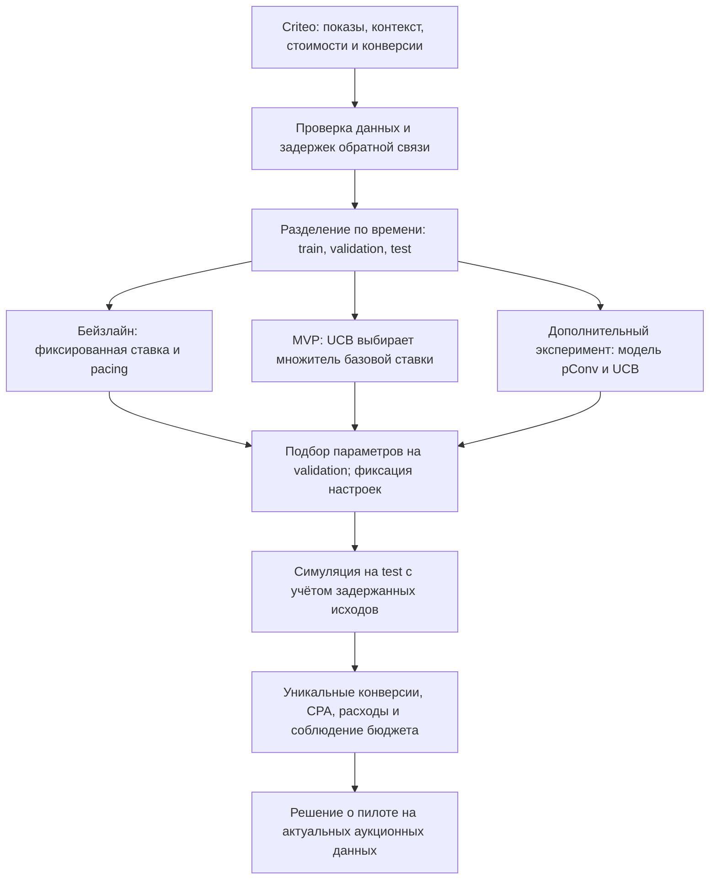
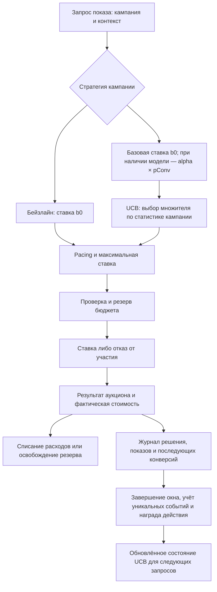

# Дизайн ML-системы: Auto Bidding System

**Версия:** MVP, итерация 1. **Дата:** 26.10.2026.
**Статус:** проектирование; исследование данных и эксперименты предстоят.

Документ подготовлен по [шаблону Reliable ML](https://github.com/IrinaGoloshchapova/ml_system_design_doc_ru/blob/main/ML_System_Design_Doc_Template.md).
Раздел 1 описывает цели и ожидания бизнеса, раздел 2 — подход к решению,
раздел 3 — проверку результата, раздел 4 — требования к внедрению.

## Термины и пояснения

| Термин | Значение |
| --- | --- |
| RTB | Покупка рекламного показа через аукцион в реальном времени |
| DSP | Система на стороне рекламодателя, которая решает, участвовать ли в аукционе и какую ставку предложить |
| UCB | Семейство алгоритмов выбора действия по верхней доверительной оценке его результативности |
| Рука UCB | Один из доступных вариантов действия; в проекте — множитель базовой ставки |
| pConv | Прогноз вероятности конверсии в течение 30 дней после показа |
| CPA | Расходы на рекламу, разделённые на число уникальных конверсий |
| Pacing | Управление темпом расходования бюджета в течение дня |
| Итерация | Работы, которые нужно выполнить до очередной проверки решения на пилоте |

## 1. Цели и предпосылки

### 1.1. Зачем идем в разработку продукта?

#### Бизнес-цель

Помочь рекламодателю получать больше конверсий при заданном дневном бюджете.
Рекламодатель задаёт ограничения кампании, а система выбирает ставки и следит
за тем, чтобы бюджет расходовался постепенно. Оператор рекламной платформы
контролирует работу системы и разбирает отклонения.

В качестве исходного подхода принимаем фиксированную ставку. Она проста,
но не меняется в зависимости от результатов кампании. При изменении трафика
одна и та же ставка может приводить либо к лишним расходам, либо к потере
полезных показов. Здесь и далее это наш бейзлайн, а не описание алгоритмов Criteo.

#### Почему ожидаем улучшение

UCB позволит сравнивать несколько уровней ставки и постепенно отдавать
предпочтение тем, которые приносят больше конверсий. При этом алгоритм продолжит
проверять менее изученные варианты, чтобы не зафиксироваться слишком рано
на случайно удачной ставке.

Если одного управления уровнем ставки окажется недостаточно, добавим прогноз
pConv. Он позволит различать показы внутри кампании: для более перспективного
контекста базовая ставка будет выше. UCB и прогнозная модель решают разные задачи:
первый выбирает уровень ставки, вторая оценивает конкретный показ.

#### Что считаем успехом итерации

Получить воспроизводимое сравнение фиксированной ставки и UCB при одинаковых
бюджетах и ограничениях. Рабочая бизнес-гипотеза — не менее 5% прироста уникальных
конверсий без превышения бюджета. Это целевой ориентир, а не полученный результат;
после исследования данных нужно проверить, позволяет ли объём событий измерить
такой эффект. Вместе с конверсиями оцениваем CPA и освоение бюджета.

### 1.2. Бизнес-требования и ограничения

#### Бизнес-требования

| ID | Требование | Ожидаемое поведение |
| --- | --- | --- |
| БТ-1 | Управлять ограничениями каждой кампании | Рекламодатель задаёт дневной бюджет и максимальную ставку |
| БТ-2 | Автоматически выбирать ставку | На запрос показа система отвечает ставкой либо отказом от участия |
| БТ-3 | Соблюдать бюджет | Расход и обязательства по открытым ставкам не превышают доступный лимит |
| БТ-4 | Распределять расходы по времени | Система снижает активность при опережении плана расходов и повышает при отставании |
| БТ-5 | Улучшать результат кампании | UCB сравнивает уровни ставки по обратной связи о конверсиях |
| БТ-6 | Объяснять решения | Можно восстановить выбранный вариант, ставку, состояние бюджета и версию алгоритма |
| БТ-7 | Безопасно отключать неудачную стратегию | Доступен возврат к фиксированной ставке при исправном контроле бюджета |

#### Бизнес-ограничения

Бюджет и максимальная ставка — жёсткие ограничения. CPA используем для сравнения
результатов, но отдельный целевой CPA в первой версии не задаём. Исследование
новых вариантов UCB тоже расходует бюджет, поэтому для него нужен ограниченный
лимит, общий с основными расходами кампании.

Для разработки используем открытый Criteo Attribution Modeling for Bidding Dataset.
Его лицензия **CC BY-NC-SA 4.0** допускает только некоммерческое использование
при соблюдении остальных условий. Данные подходят для исследования решения;
коммерческий запуск требует собственных данных или других прав на использование.

Данные содержат только состоявшиеся показы, а стоимости преобразованы.
Поэтому расчёты ведём в условных единицах и не переносим офлайн-CPA в реальную
валюту. Полноценную оценку новых ставок на всех аукционах эти логи не обеспечивают.

#### Ожидания от итерации и процесс пилота

Сначала проверяем качество данных, затем сравниваем бейзлайн и UCB в симуляторе.
Оператор задаёт кампании, бюджет и ограничения; на выходе получает отчёт
по конверсиям, CPA, расходам и поведению алгоритма. Прогноз pConv добавляем
отдельным экспериментом, если анализ покажет пользу контекстных признаков.

Успешный офлайн-этап даёт основание подготовить пилот на актуальном потоке
аукционов. Перед реальными расходами нужны проверка без отправки ставок,
лимит бюджета эксперимента и возможность быстро вернуть бейзлайн.
Критерии оценки пилота приведены в разделе 3.

### 1.3. Что входит в скоуп проекта/итерации, что не входит

#### Что делаем в MVP

- Готовим данные Criteo и отчёт об их качестве.
- Реализуем фиксированную ставку и UCB для выбора множителя ставки по кампании.
- Подключаем общий контроль бюджета и pacing для всех стратегий.
- Сравниваем стратегии в симуляторе и сохраняем настройки и результаты запуска.
- Проверяем необходимость модели pConv; добавляем её, если эксперимент
  подтверждает пользу относительно UCB без прогнозной модели.

В рамках MVP закрываем БТ-1–БТ-6 на уровне локального прототипа,
а БТ-7 — переключением стратегии в конфигурации. Гарантии бюджетного контроля
при параллельных реальных торгах проверяются отдельно перед внедрением.

#### Что не делаем в этой итерации

Не подключаем реальные рекламные биржи, платежи и интерфейс рекламодателя.
Не разрабатываем собственную модель атрибуции или оценку причинного эффекта
рекламы. Промышленная отказоустойчивость и распределённое управление бюджетом
относятся к следующему этапу.

#### Качество решения и технический долг

Каждый эксперимент должен сохранять версию кода и данных, временные границы
выборок, набор действий UCB, параметры pacing и seed. Проверки кода выполняются
через Ruff и pre-commit. Результаты должны воспроизводиться по этим настройкам.

Основной технический долг — ограниченная симуляция аукциона, отсутствие
промышленного хранилища состояния UCB и распределённого учёта бюджета.
Перед запуском в реальной DSP эти части нужно заменить или проверить на
полном потоке запросов, а не только на исторически купленных показах.

### 1.4. Предпосылки решения

**Единица решения — запрос на показ в рамках кампании.** UCB ведёт отдельную
статистику по кампаниям, поскольку аудитория, цены и частота конверсий различаются.
Набор действий небольшой и фиксируется до теста: например, множители
`0.5`, `0.75`, `1.0`, `1.25`, `1.5`. Это стартовая сетка для эксперимента,
которую уточним на валидации, а не по результатам тестовой выборки.

**Горизонт результата — 30 дней после показа.** Так определён `conversion`
в [карточке Criteo](https://huggingface.co/datasets/criteo/criteo-attribution-dataset).
Конверсия появляется не сразу; отсутствие события сегодня ещё не означает
отрицательный результат. Это влияет и на обучение модели, и на обновление UCB.

**Контроль бюджета отделён от выбора ставки.** Даже если UCB или прогнозная
модель ошибаются, система обязана соблюдать лимиты. Дневной бюджет и максимальная
ставка задаются отдельно для каждой кампании.

**Прогноз конверсии — дополнительный компонент.** Первая версия UCB может
работать с постоянной базовой ставкой. Если добавляется модель, для начала
используем логистическую регрессию с категориальными признаками. Более сложный
алгоритм имеет смысл только после проверки этой версии.

**Данные пока не исследованы.** По описанию источника доступны около 16,5 млн
показов за 30 дней. Достаточность конверсий по кампаниям, качество стоимостей,
полноту окна наблюдения и доступность признаков нужно подтвердить до экспериментов.

## 2. Методология

### 2.1. Постановка задачи

Основная задача — последовательный выбор ставки при ограниченном бюджете.
Мы рассматриваем её как задачу многорукого бандита: каждый вариант ставки —
отдельное действие, результат которого известен с задержкой. Цель — получить
больше уникальных конверсий за день, не превысив бюджет кампании.

#### Бейзлайн

Фиксированная базовая ставка `b0` с ограничением максимальной ставки и pacing.
Параметры подбираются на валидации. Бейзлайн нужен для проверки того, приносит
ли адаптация ставок пользу относительно простого стабильного решения.

#### Основное решение: семейство UCB

Решение не привязано к одной версии UCB. Рассматриваем UCB1 как начальный
вариант, KL-UCB для бинарного вознаграждения, а также Sliding-Window UCB
и Discounted UCB, которые позволяют учитывать изменение результатов во времени.
При переходе к выбору действия с учётом контекста показа можно отдельно
рассмотреть LinUCB; это альтернатива неконтекстному выбору множителя,
а не другое название модели pConv.

Конкретный алгоритм выбираем на валидации по бизнес-метрикам, устойчивости
к задержкам и стоимости исследования. Для каждого кандидата отдельно определяем
статистику, обработку ожидающих исходов и параметры; формула ниже иллюстрирует
начальный вариант UCB1 и не задаёт обязательную формулу для всего семейства.

В начальном неконтекстном варианте на каждом допустимом запросе UCB выбирает
множитель `m` базовой ставки.
Для каждого множителя храним число завершённых наблюдений и среднее вознаграждение.
В начальном варианте оценка складывается из среднего результата и бонуса
за неопределённость:

```text
score(a) = mean_reward(a) + c × sqrt(log(1 + N) / n(a))
```

Здесь `n(a)` — число завершённых наблюдений для действия, `N` — их общее число
в кампании, `c` — параметр исследования. Для варианта без завершённых наблюдений
формулу не вычисляем: начальные действия чередуются, а их доля и расходы
ограничены настройками исследования. Ожидающие результата запросы учитываются
отдельно, чтобы задержка конверсий не приводила к бесконтрольному исследованию.

Обратная связь привязывается к выбранному действию, а не ко всем вариантам
ставки сразу. Для проигранного аукциона вознаграждение равно нулю; для купленного
показа оно остаётся неизвестным до завершения окна наблюдения. После этого
засчитываем `1`, если показу назначена уникальная конверсия, иначе `0`.
Если событие связано с несколькими купленными показами кампании, один кредит
получает последний из них до события в пределах окна. Это единое правило учёта
для эксперимента, а не попытка восстановить причинное влияние рекламы.
В проектном отчёте одно событие повторно дедуплицируется между кампаниями.

Обновления выполняются только по завершённым исходам; ранние положительные
конверсии не смешиваются с ещё незавершёнными отрицательными. Состояние UCB
сохраняется между днями, дневной счётчик расходов сбрасывается отдельно.
При смене набора действий или формулы базовой ставки используется новая версия
состояния: статистику разных стратегий нельзя молча объединять.

UCB помогает управлять исследованием, но сам по себе не решает задачу
оптимального распределения бюджета при разных ценах действий. Бюджет и pacing
контролируются отдельно; полезность сочетания проверяется экспериментом.
Теоретические гарантии обычного UCB не переносим автоматически на задержанные,
зависимые конверсии и меняющийся рекламный трафик.

#### При необходимости: прогноз вероятности конверсии

Модель оценивает `P(conversion = 1 | контекст показа)`. Она использует только
признаки, доступные до решения: время, кампанию и категориальный контекст.
Первый кандидат — логистическая регрессия с кодированием категорий и проверкой
калибровки. Модель обучается по кампаниям совместно, с идентификатором кампании
как признаком.

Без модели базовая ставка равна `b0`. С моделью она равна `alpha × pConv(x)`.
В обоих случаях итоговый расчёт одинаков:

```text
bid = min(b_max, base_bid(x) × selected_ucb_multiplier × pacing_multiplier)
```

После расчёта система проверяет доступный бюджет. Для бейзлайна множитель UCB
равен единице. Прогноз pConv не заменяет реальные конверсии в вознаграждении UCB.
Решение о подключении модели принимается по дополнительному приросту конверсий
при том же бюджете, а не только по качеству классификации.

### 2.2. Блок-схема решения

#### Подготовка и сравнение вариантов



#### Обработка запроса и обратная связь



В симуляторе Criteo заменяет поток запросов, а правило покупки по `cost` —
результат аукциона. В сервисе статистика UCB и бюджет доступны между запросами.
Модель pConv, если она включена, обновляется отдельным процессом обучения;
каждая новая версия проверяется до подключения к торгам.

### 2.3. Этапы решения задачи

#### Этап 1. Подготовка данных

Основной источник — [Criteo Attribution Modeling for Bidding Dataset](https://huggingface.co/datasets/criteo/criteo-attribution-dataset).
Строка соответствует показу, а не всем возможным запросам на аукцион.

**Признаки и контекст:**

| Данные | Источник и доступность | Кто готовит | Качество проверено |
| --- | --- | --- | --- |
| Время и кампания | `timestamp`, `campaign` в Criteo | DS / DE | Нет |
| Контекст показа | `cat1`–`cat9` в Criteo | DS / DE | Нет |
| Пользовательская последовательность | `uid`, только для связывания и анализа | DS / DE | Нет |
| История кликов | `time_since_last_click`, возможное расширение после проверки доступности до показа | DS | Нет |

**Цели и обратная связь:**

| Данные | Источник и назначение | Кто готовит | Качество проверено |
| --- | --- | --- | --- |
| Конверсия в окне 30 дней | `conversion`, цель прогнозной модели | DS | Нет |
| Событие и время конверсии | `conversion_id`, `conversion_timestamp`, учёт уникальных событий и задержек UCB | DS / DE | Нет |
| Историческая атрибуция | `attribution`, дополнительный отчёт | DS | Нет |
| Стоимости | `cost` для симулятора; `cpo` в основной задаче не используется | DS | Нет |

`click`, `click_pos`, `click_nb`, сведения о конверсии и её атрибуции не входят
в признаки текущего показа. `cost` доступен оценке после решения и не передаётся
алгоритму выбора ставки. `uid` в первой прогнозной модели не используем.

На выходе этапа — проверенная схема данных, отчёт по пропускам, задержкам,
повторам конверсий, стоимости и объёму событий по кампаниям. Отдельно проверяем,
достаточно ли истории, чтобы UCB успел получить обратную связь.

#### Этап 2. Формирование выборок и правил оценки

Данные делим по времени: первые 60% периода — train, следующие 20% — validation,
последние 20% — test. Если нужна модель, первую половину validation используем
для калибровки, вторую — для выбора настроек. Test не участвует в подборе
действий UCB, коэффициентов, бюджетов и параметров pacing.

Для сравнения задаём одинаковый дневной бюджет кампании: 50% её среднего
дневного расхода на validation. Это сценарий ограниченного бюджета, фиксируемый
до test. Кампании без истории на validation рассматриваем отдельно.
День определяется как 86 400 секунд от начала `timestamp`; календарный часовой
пояс из анонимизированных данных не восстанавливаем.

**Важное ограничение:** поток показов покрывает 30 дней, и горизонт конверсии
тоже равен 30 дням. Поэтому обычное разбиение с готовыми метками пригодно лишь
для ретроспективного исследования. Оно не воспроизводит обучение на полностью
созревших метках до начала тестового периода.

Для UCB нужен отдельный проход по времени событий: завершённые результаты
поступают только тогда, когда были бы доступны системе. Отсутствие конверсии
считаем подтверждённым только после полного окна с известной границей наблюдения.
Максимальная дата положительного события не подтверждает полноту отрицательных
исходов. Если на этом потоке UCB не получает достаточно завершённых наблюдений,
фиксируем невозможность проверить адаптацию. Более длинный поток нужен для
содержательного теста; сценарии с искусственно сокращённой задержкой допустимы
только как отдельно помеченные проверки алгоритма, а не бизнес-результат.

#### Этап 3. Бейзлайн и UCB

Симулятор проходит показы в хронологическом порядке. Принимаем явное допущение:
`cost` — условный порог покупки. Если ставка не ниже порога и бюджет позволяет,
показ считается купленным, списывается `cost`; иначе он пропускается.
Преобразованный `cost` не является достоверной ценой альтернативной ставки,
поэтому это ограниченная модель, а не точное воспроизведение аукциона Criteo.

Бейзлайн и UCB получают одинаковые возможности и ограничения. В каждом запуске
UCB видит только обратную связь собственных выбранных действий. В конце теста
нельзя задним числом подать ему все исходы и пересчитать уже сделанные ставки.
Оставшиеся неизвестными награды отражаются в отчёте.

Проверяем бюджет, смену дня, отказы, начальное исследование, отсутствие
завершённых наград и восстановление состояния после перезапуска. Для повторных
конверсий проверяем единый кредит, а для задержанных исходов — отсутствие
преждевременных нулей и использования будущих событий.

#### Этап 4. Проверка необходимости прогнозной модели

Модель обучаем на train; кодирование признаков также настраиваем только там.
Неизвестные категории должны обрабатываться без переобучения на test.
Оцениваем PR-AUC для редкой целевой метки, log loss и калибровку вероятностей.
Проверяем пересечения конверсий между выборками и их влияние на результаты.

Модель включаем в стратегию только отдельным сравнением «UCB» против
«UCB + pConv». Параметры и состояние UCB для этих вариантов независимы.
Если дополнительный компонент не улучшает бизнес-метрики или данных недостаточно
для вывода, оставляем более простое решение. До запуска пилота нужно проверить
работу обучения с реальным 30-дневным ожиданием меток на более длинном потоке.

## 3. Подготовка пилота

### 3.1. Способ оценки пилота

Первый этап — сравнение в симуляторе. Основная метрика — число уникальных
`conversion_id` у выбранных показов. Значение `-1` исключается; в итоговом отчёте
события повторно не считаются между днями и кампаниями. Дополнительно показываем
CPA, расходы, долю освоенного бюджета, профиль расходов и долю действий UCB,
для которых результат ещё неизвестен. При нуле конверсий CPA не определён.

Сравнение проводим попарно по кампаниям и дням. При достаточном количестве дней
оцениваем неопределённость эффекта с помощью блочного bootstrap, сохраняя
обе стратегии в одном блоке и пересчитывая уникальные конверсии.
При недостатке событий не заявляем статистическую значимость.

Данные Criteo отражают выбор прежней стратегии, а исходов проигранных аукционов
нет. Поэтому офлайн-результат не доказывает рост реальных конверсий и не измеряет
причинный эффект рекламы. Следующий этап — контролируемое онлайн-сравнение
на непересекающихся группах кампаний с отдельными бюджетами. Размер, длительность
и распределение групп определяются по фактическому трафику и задержкам до запуска.

### 3.2. Что считаем успешным пилотом

Рабочая цель — прирост уникальных конверсий не менее 5% при одинаковом бюджете,
без его превышения и без нарушения максимальной ставки. CPA и освоение бюджета
рассматриваем вместе с основной метрикой, чтобы не принять рост расходов
или случайный всплеск за улучшение стратегии.

Пилот успешен, если эффект устойчив, обратная связь корректна, расходы
контролируются и операторы могут объяснить выбор ставки. Если исследование UCB
не успевает завершиться из-за задержек или малой частоты конверсий, сначала
пересматриваем данные и длительность наблюдения, а не объявляем алгоритм успешным.

### 3.3. Подготовка пилота

До начала пилота оцениваем ресурсы на обработку данных, хранение состояния
по кампаниям и ожидаемую задержку ответа. Для прототипа принимаем ориентир:
p95 обработки запроса до 50 мс при 100 запросах/с на одном экземпляре.
Это цель нагрузочной проверки, а не измеренный SLA.

Фиксируем допустимый бюджет исследования, правила остановки и возврата к
бейзлайну. Для коммерческого пилота проверяем права на данные, подключение биржи
и сверку фактических расходов. При неопределённом состоянии бюджета ставки
останавливаются.

## 4. Внедрение

### 4.1. Архитектура решения

Сервис ставок получает контекст запроса и настройки кампании, выбирает действие
UCB, рассчитывает ставку и обращается к контролю бюджета. Хранилище состояния
содержит статистику действий и ожидающие результаты. Обработчик событий
связывает показы и конверсии, завершает наблюдения и обновляет статистику.
При наличии pConv процесс обучения публикует проверенные версии модели отдельно.

### 4.2. Описание инфраструктуры и масштабируемости

Для MVP достаточно локального последовательного симулятора и сохраняемого
состояния эксперимента. Это позволяет проверить алгоритм без инфраструктуры биржи.
Для параллельного сервиса понадобятся общее хранилище состояния UCB,
атомарный учёт бюджета и очередь событий с защитой от повторной обработки.
Выбор конкретных сервисов сделаем по результатам прототипа и нагрузочной проверки.

### 4.3. Требования к работе системы

Перед отправкой ставки резервируется максимальное обязательство, после исхода
аукциона оно заменяется расходом или освобождается. Потерянное подтверждение
требует сверки: резерв нельзя освобождать только по таймауту, если расход возможен.
Сбой UCB допускает возврат к бейзлайну; сбой контроля бюджета означает отказ
от торгов. Сбой дополнительной модели допускает переход на версию UCB без pConv
с отдельным состоянием.

### 4.4. Безопасность системы

Доступ к настройкам кампаний и запуску стратегий должен быть ограничен ролями.
Изменения лимитов и переключения стратегий журналируются. Секреты подключения
к биржам хранятся вне репозитория.

### 4.5. Безопасность данных

Пользовательские идентификаторы не публикуются в отчётах и примерах.
Доступ к исходным данным и сроки их хранения ограничиваются задачами проекта;
условия лицензии сохраняются для производных данных. Для реальной интеграции
потребуется отдельная проверка требований к обработке данных пользователей.

### 4.6. Издержки

Основные затраты — подготовка данных, хранение истории и ожидающих исходов,
обработка запросов и, при необходимости, обучение pConv. Денежную оценку можно
сделать после измерения объёма состояния и времени обработки; сейчас подтверждённого
расчёта стоимости инфраструктуры нет. Рекламный бюджет учитывается отдельно.

### 4.7. Точки интеграции

Внешние точки — поток запросов биржи, результаты аукционов и события конверсий.
Внутренние — настройки кампании, бюджетный учёт, состояние UCB и хранилище моделей.
Решение и последующие события связываются по идентификатору запроса; повторная
доставка события не должна повторно менять расходы или награду. Контракты API
определяются при подключении конкретной биржи.

### 4.8. Риски

| Риск | Как повлияет | Что делаем |
| --- | --- | --- |
| Мало конверсий или длинная задержка | UCB долго не различает действия | Ограничиваем исследование; проверяем достаточность истории до пилота |
| Исторически отобранные показы | Офлайн-эффект не переносится на весь аукцион | Не делаем выводов о полном рынке без новых данных и онлайн-проверки |
| Преобразованные стоимости | Нельзя получить достоверный валютный CPA | Работаем в условных единицах и явно фиксируем допущения симулятора |
| Повторные показы перед одной конверсией | Вознаграждение и бизнес-метрики завышаются | Один кредит событию по общему правилу, дедупликация итогов |
| Изменение аудитории и цен | Накопленные оценки UCB устаревают | Следим за результатами по времени; проверяем необходимость ограниченного окна статистики |
| Параллельные ставки или повторные события | Возможен перерасход и неверные обновления | Резервируем бюджет, сохраняем состояние, обрабатываем события идемпотентно |

Мониторим расходы, обязательства, темп освоения бюджета, задержку ответа,
ошибки, распределение выбранных действий и долю незавершённых наград UCB.
Для pConv дополнительно контролируем калибровку на созревших метках.

## Источники

1. [Reliable ML: шаблон дизайн-документа](https://github.com/IrinaGoloshchapova/ml_system_design_doc_ru/blob/main/ML_System_Design_Doc_Template.md).
2. [Criteo Attribution Modeling for Bidding: описание и условия использования](https://huggingface.co/datasets/criteo/criteo-attribution-dataset).
3. Eustache Diemert, Julien Meynet, Pierre Galland, Damien Lefortier.
   [Attribution Modeling Increases Efficiency of Bidding in Display Advertising](https://arxiv.org/abs/1707.06409), 2017.
4. Pooria Joulani, Andras Gyorgy, Csaba Szepesvari.
   [Online Learning under Delayed Feedback](https://proceedings.mlr.press/v28/joulani13.html), 2013.
5. Aurélien Garivier, Olivier Cappé.
   [The KL-UCB Algorithm for Bounded Stochastic Bandits and Beyond](https://proceedings.mlr.press/v19/garivier11a.html), 2011.
6. Aurélien Garivier, Eric Moulines.
   [On Upper-Confidence Bound Policies for Non-Stationary Bandit Problems](https://arxiv.org/abs/0805.3415).
7. Lihong Li, Wei Chu, John Langford, Robert E. Schapire.
   [A Contextual-Bandit Approach to Personalized News Article Recommendation](https://www.microsoft.com/en-us/research/wp-content/uploads/2016/02/p661.pdf), 2010.
