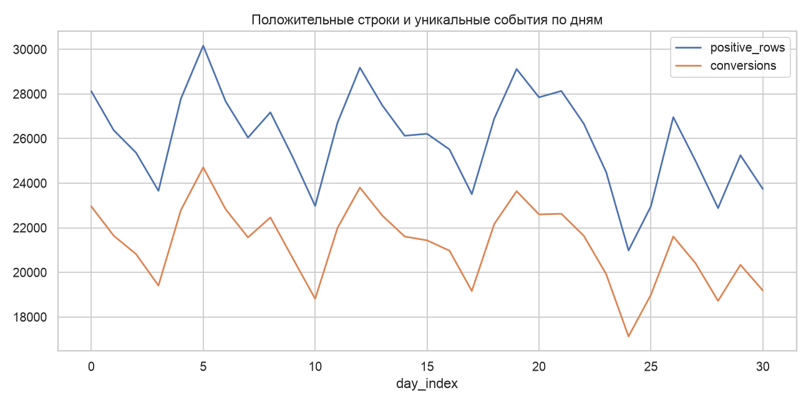
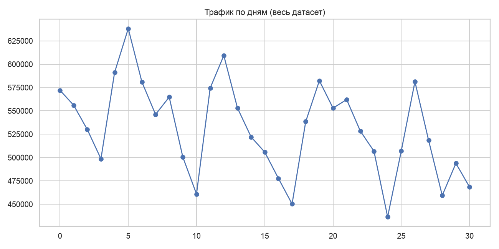
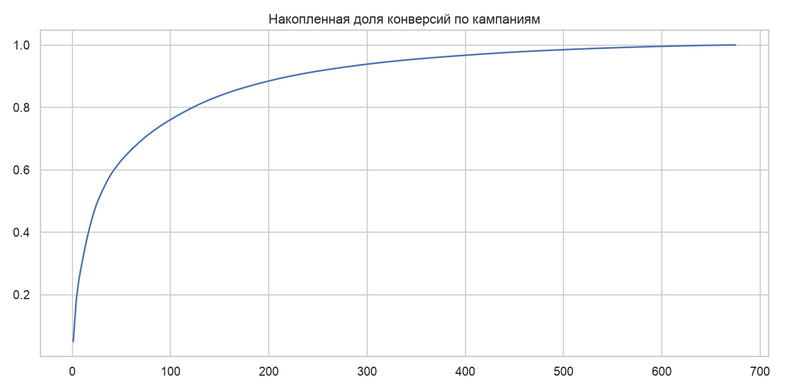
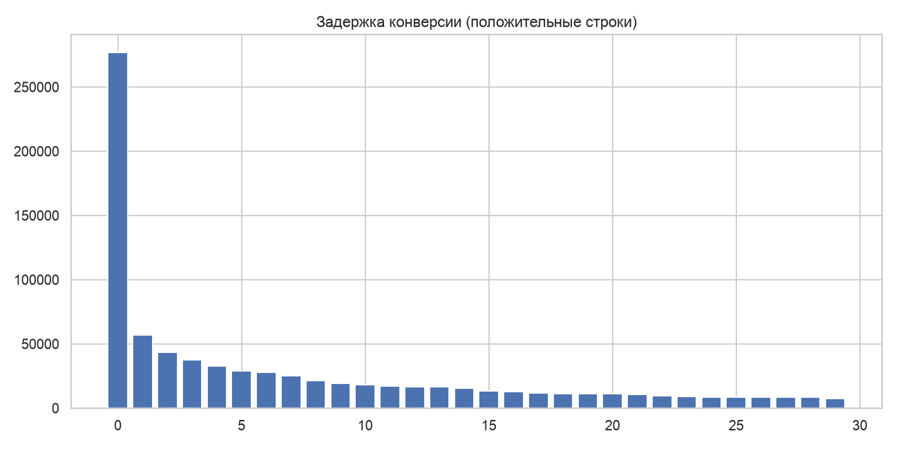
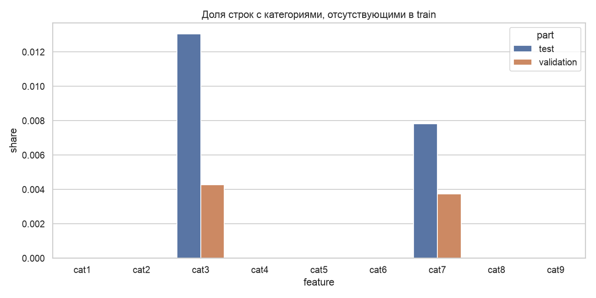
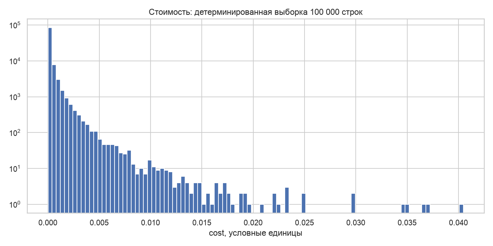

# EDA: Criteo Attribution Modeling for Bidding

Дата анализа: 18.11.2026.

## Состав и воспроизводимость

Анализ выполнен на полном исходном архиве: **16,468,027 строк**,
**6,142,256 пользователей**, **675 кампаний**, **22 поля**.
Диапазон показов — 0–2,671,199 секунд (30 дней 22 часа; 31 суточный интервал).
Ревизия `904188a63cbad78bee43cd26ff5ee4ac77903986`, размер **653,015,824 байт**.
SHA-256: `94ac7a465564349bc7ba008602211d5990a3c53cc133abc0aadef61ea2391a98`. Источник: [Criteo](https://huggingface.co/datasets/criteo/criteo-attribution-dataset/resolve/904188a63cbad78bee43cd26ff5ee4ac77903986/criteo_attribution_dataset.tsv.gz).
Карточка источника даёт округлённые сведения; числа здесь получены из файла,
включая существенно большее число конверсий, чем указанное в её краткой сводке.

Расчёты всех таблиц выполнены на полном наборе. Только гистограмма `cost`
использует выборку 100 000 строк с seed 42. Локальная DuckDB ограничена 1 ГБ,
используются два потока и дисковая выгрузка временных данных. Ограничение относится
к DuckDB, а не ко всей памяти Python. Время запуска и окружение зависят от машины.
Зависимости зафиксированы в `uv.lock`; данные, БД и временные файлы в Git не входят.
Лицензия исходных и производных данных: CC BY-NC-SA 4.0; авторство — Eustache Diemert,
Julien Meynet, Pierre Galland, Damien Lefortier, [статья](https://arxiv.org/abs/1707.06409).

## Качество и специальные значения

NULL во всех полях: **0**. Полных дубликатов: **0**.
Недопустимые метки и стоимости, противоречия `conversion`/времени/идентификатора,
атрибуция без конверсии, задержки вне окна: **0** по реализованным проверкам.
Подробности: `quality.csv`, `field_quality.csv`, `schema.csv`.

При этом `time_since_last_click=-1` встречается в **8,770,820**
строках (**53.26%**). Служебное значение
нужно сохранить как отдельное состояние. Отсутствие NULL не означает отсутствие
неизвестной истории. В `cat*` не обнаружено -1 и 0; наличие иных специальных
кодов нельзя определить без словаря владельца данных.

**Вывод:** строгая схема подходит для загрузки, но семантические ограничения
и служебные значения нужно учитывать отдельно; тихую очистку не выполняем.

## Конверсии и ключ события

Положительных строк: **806,196 (4.8955%)**;
кликов: **5,947,563**, строк с исторической атрибуцией: **442,424**.
Различных `conversion_id`: **435,810**.
У **2 910** идентификаторов разные пользователи и времена.
Составной ключ `(uid, conversion_id, conversion_timestamp)` даёт **438,730 событий**;
пара `(uid, conversion_id)` однозначно задаёт время. Для составного ключа
пересечений между кампаниями не обнаружено. Причину совпадений исходных ID
датасет не объясняет, называть их доказанными хеш-коллизиями нельзя.

На событие приходится в среднем **1.838** положительных строк.
Дневные уникальные события могут повторяться между днями: сумма дневных значений
не является итогом периода. Проверки: `conversion_consistency.csv`, `event_key_audit.csv`,
`contact_distribution.csv`. В `conversion_consistency.csv` группы построены по сырому ID,
а в `contact_distribution.csv` сущность conversion — по составному ключу.

**Вывод:** сумма меток завышает число событий, а дедупликация только по сырому ID
его занижает. Используем составной ключ, не публикуя значения пользователей.



## Временная динамика

Суточный трафик меняется от **436,408**
до **638,165** показов, активных кампаний — от
**657** до **671**.
Последний интервал неполный. Дневные расходы сохранены в `daily.csv` и `daily_cost.csv`.

**Вывод:** случайный split скрывает динамику; нужны хронологические выборки,
сравнение по одинаковым дням и общий pacing. Суточные интервалы относительные:
реальные даты и часовой пояс неизвестны.



## Кампании и повторные контакты

Кампаний без наблюдаемых событий нет, но **279** имеют менее 100 событий,
**4** — менее 10. Десять кампаний с наибольшим числом событий концентрируют
**30.40%** всех событий.
В среднем на пользователя приходится **2,681** показа; максимум — **880**.

**Вывод:** общие метрики могут скрывать слабое покрытие малых кампаний.
Отдельный UCB по каждой кампании будет получать обратную связь неравномерно;
нужны лимит исследования и отчёт о достаточности событий. Пороги 10/100 —
описательные, они не являются расчётом мощности или основанием удалить кампании.



## Задержка обратной связи

Квантили задержки положительных строк: медиана **3,745 дня**,
p90 **20,98 дня**, p95 **25,13 дня**, p99 **28,98 дня**, максимум чуть меньше 30 дней.
Это распределение по положительным строкам, взвешенное повторными показами,
а не распределение по независимым покупкам. Таблицы: `delay_quantiles.csv`, `delay_hist.csv`.

Только **544 426 строк (3,31%)** имеют полный календарный интервал 30 дней
до конца потока показов. У **182 792 положительных строк** событие находится
после конца потока. У **169 692 train-строк** исход наступает не раньше начала validation.

**Вывод:** готовую метку нельзя немедленно отдавать UCB. Нужен проход по времени
с очередью ожидающих наград; текущий снимок слаб для проверки адаптации.
Граница потока показов не является подтверждённой границей сбора исходов;
число календарно завершившихся окон не доказывает наблюдаемость отрицательных меток.



## Признаки и временной сдвиг

Кардинальности `cat1`–`cat9` соответственно:
**9, 70, 1 829, 21, 51, 30, 57 196, 11, 30**.
В test неизвестны train-категории `cat3` у **41 492 строк (1,30%)**,
`cat7` у **24 920 (0,78%)**, `cat2` у четырёх строк.
Остальные поля в этом сравнении не содержат новых категорий.

**Вывод:** нужны unknown-обработка и разреженное кодирование, особенно для `cat7`.
Смысл `cat*` не раскрыт — числовые коды не являются количественными признаками.
Частоты десяти самых частых категорий без их значений сохранены в `category_top.csv`.
Будущие клики, метки и стоимость не являются признаками решения о текущей ставке.



## Стоимость и ограничения аукционной оценки

Медиана `cost` — **0,00007610**, p99 — **0,00345560**, максимум — **0,05834483**;
минимум **0,00001**, нулевых и отрицательных значений нет.
`cpo` также положителен, но ни его, ни `cost` нельзя переводить в реальные деньги:
оба поля преобразованы владельцем данных. Все квантили — по полному набору;
гистограмма ниже — по детерминированной выборке 100 000 строк, с логарифмической осью частот.

**Вывод:** хвост стоимостей важен для бюджетных ограничений.
Сравнение `bid >= cost` допустимо только как явно оговорённая симуляция.
Нет исходных ставок, проигранных аукционов и вероятностей выбора действий
исторической стратегии, поэтому достоверную off-policy-оценку по этим логам не получаем.



## Выборки и дальнейшие решения

Границы по времени: **1 607 720** и **2 136 960** секунд.
Train: **9 941 432** строки; validation: **3 344 259**; test: **3 182 336**.
Доли положительных строк — **4,8919%, 4,9691%, 4,8296%**.
Между train и test пересекаются **894 475 пользователей** и **13 671 составное событие**;
между validation и test — **19 736 событий**. См. `splits.csv`, `split_overlap.csv`.

**Вывод:** временное разделение полезно, но не убирает пересечения и ожидание меток.
Ретроспективную оценку отделяем от реалистичной проверки. Для последней нужны
train-период, 30 дней ожидания, validation, 30 дней ожидания, test и ещё 30 дней
наблюдения. Размер периодов и необходимое число показов рассчитываются после
оценки мощности на актуальных данных, а не выводятся из общего количества строк.

Модели и стратегии в этой итерации не обучались. Следующие эксперименты:
константный прогноз, логистическая регрессия и отдельно семейство UCB с задержками.
Графики тестового периода используются для аудита качества и покрытия, не для
подбора правил стратегии. Данные не удалялись и метрики не выдаются за онлайн-эффект.

## Повторный запуск

Из корня проекта:

```bash
uv sync --locked --group eda
uv run --group eda python scripts/download_data.py
uv run --group eda python scripts/run_eda.py
uv run --group eda python scripts/build_report.py
uv run --group eda python -m unittest discover -s tests
uv run --group eda jupyter lab notebooks/01_criteo_eda.ipynb
```

Последняя команда открывает уже выполненный ноутбук. В нём читаются небольшие
агрегаты, а полный расчёт выполняется `run_eda.py`. Для изменения выводов после
смены данных нужно пересмотреть текст отчёта: он содержит интерпретацию именно
зафиксированной ревизии. Источник и контрольная сумма — в `manifest.json`.

`conversions` в таблицах summary/daily/campaigns/splits — составные события.
`raw_conversion_ids` — число исходных идентификаторов, не надёжный ключ события.
Положительные строки и уникальные события измеряют разные величины.
